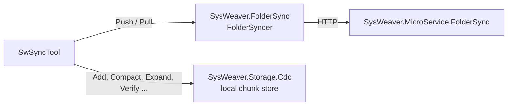

# SwSyncTool

[⬆ SysWeaver.Tools overview](../README.md)

> Command line client for SysWeaver's content-defined chunking: pushes and pulls folders to and from a SysWeaver folder sync service, and compacts, expands, verifies and maintains local `.swcompact` archives and their chunk store.

| | |
|---|---|
| **Layer** | Tool (command line) |
| **Kind** | Command line tool |

## Purpose

Deploys and distributes folders (applications, content) efficiently: only chunks that the other side doesn't have are transferred. The same chunk store can be used locally to deduplicate files into small `.swcompact` archives.

## How it fits into SysWeaver



Push and Pull use the [SysWeaver.FolderSync](https://github.com/dosh1974/SysWeaver/blob/main/SysWeaver.FolderSync/README.md) client against a server running [SysWeaver.MicroService.FolderSync](https://github.com/dosh1974/SysWeaver/blob/main/SysWeaver.MicroService.FolderSync/README.md); the local operations use [SysWeaver.Storage.Cdc](https://github.com/dosh1974/SysWeaver/blob/main/SysWeaver.Storage.Cdc/README.md). A prebuilt copy is kept in [`SysWeaver/_tools/SwSyncTool`](https://github.com/dosh1974/SysWeaver/blob/main/_tools/README.md).

## Key features

- Operations:
  - `Push <Server> <RepoName> <LocalFolder>..` — update a managed folder on the sync service from one or more local folders (`-Ignore` masks, `-Comment`, `-OnNew` / `-OnNop` API to call afterwards with the same session)
  - `Pull <Server> <RepoName> <LocalFolder>` — update a local folder from a shared folder on the sync service
  - `Add`, `Compact`, `Expand`, `Recover`, `Verify`, `Touch`, `Stats` — add files to the local chunk store, create / expand `.swcompact` archives (`Recover` replaces missing chunks with a marker), verify them, mark their chunks as used, or show statistics; arguments are files or folders with wildcards
  - `Report`, `QuickReport`, `Prune [days]` — report chunk store usage, or PERMANENTLY remove chunks unused for a number of days (default 400, minimum 3)
- Push and Pull activate the synchronised folder unless `-NoActivate` is given, and use content-defined chunking unless `-NoCdc` is given
- The local chunk store folders come from the SysWeaver folder configuration ([`SwSyncTool.Config.json`](SwSyncTool.Config.json), `AllFolders` / `UserFolders`) or `-Folders`

## Using it

```
SwSyncTool <Operation> [Arguments..] [options]

  -User <name> -Password <pwd>   Credentials for Push / Pull (or -CredFile <file>)
  -Ignore <masks>                Push: wildcard masks of files to skip, separated by ';' (ex: *.pdb)
  -NoActivate                    Push / Pull: don't activate the synchronised folder
  -OutputDir <folder>            Compact / Expand / Recover: output folder
  -MaxConcurrency <n>            Push / Pull: concurrency (default: based on the hardware threads)
  -?                             Help (all options, operations and the exit codes)
```

Example: `SwSyncTool Push https://myserver/ MyApp .\bin\Release\publish -Ignore *.pdb -User deploy -Password secret`

Exit codes: 0-2 as all tools, 3 if the operation failed for one or more items, see [EXIT CODES](../README.md#exit-codes).

## Limitations and considerations

- `Verify` reports missing chunks but only an exception while reading an archive gives exit code 3
- `-ChunkSize` currently requires `-Folders` as well (else the option handling throws and the exit code is 1)
- `-IgnoreCertErrors` accepts any server certificate; only use it for tests
- The project targets x64 (`PlatformTarget`)

## Relationships

- **Project:** [`SwSyncTool.csproj`](SwSyncTool.csproj)
- **Builds on:** [SysWeaver.CommandLine](https://github.com/dosh1974/SysWeaver/blob/main/SysWeaver.CommandLine/README.md), [SysWeaver.Common](https://github.com/dosh1974/SysWeaver/blob/main/SysWeaver.Common/README.md), [SysWeaver.Compression](https://github.com/dosh1974/SysWeaver/blob/main/SysWeaver.Compression/README.md), [SysWeaver.FolderSync](https://github.com/dosh1974/SysWeaver/blob/main/SysWeaver.FolderSync/README.md), [SysWeaver.Storage.Cdc](https://github.com/dosh1974/SysWeaver/blob/main/SysWeaver.Storage.Cdc/README.md)
